<div dir="rtl">

<div align="center">

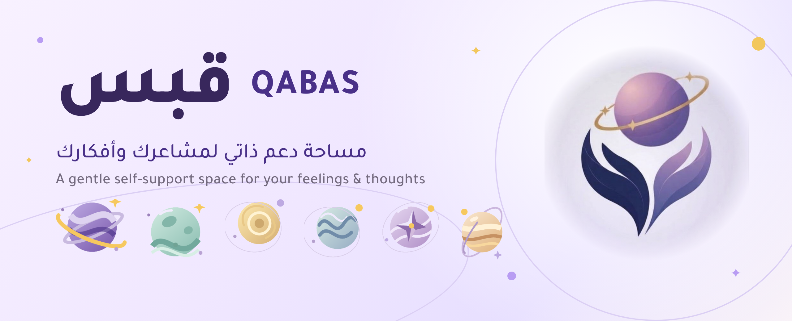

<br>

[🇬🇧 English](README.md) · **🇸🇦 العربية**

<br>


%20·%20English-E9B872?style=flat-square)


</div>

---

## ✨ عن قبس

**قبس** تطبيق عربي للصحة النفسية والدعم الذاتي. يقدّم مساحة هادئة وآمنة تساعدك على فهم مشاعرك وترتيب أفكارك وأخذ خطوات صغيرة ولطيفة نحو الأفضل.

بدلاً من الاستبيانات الجافة، يحوّل قبس الدعم الذاتي إلى **رحلة بين ستة كواكب**. يركّز كل كوكب على احتياج واحد، مثل الهدوء أو اللطف مع النفس أو اتخاذ قرار، وينقسم إلى **محطات** قصيرة فيها تمارين تفاعلية ومتحركة.

الأمان جزء أساسي من التصميم. زر **«ساعدني الآن»** موجود دائماً على بُعد لمسة واحدة، وهناك فحص أمان يعمل على الجهاز نفسه قبل خروج أي نص منه.

> 💜 المحتوى مكتوب بلهجة شامية دافئة وقريبة، والواجهة تدعم الاتجاه من اليمين لليسار بالكامل، مع خيار الواجهة الإنجليزية.

---

## 🪐 الكواكب الستة

<table>
<tr>
<td align="center" width="16%">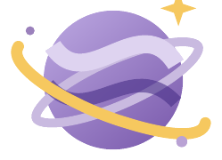<br><b>السكينة</b><br><sub>افهم شعورك</sub></td>
<td align="center" width="16%">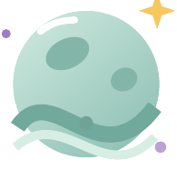<br><b>المواساة</b><br><sub>خطوة حنونة لنفسك</sub></td>
<td align="center" width="16%">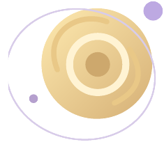<br><b>الوصال</b><br><sub>افهم احتياجك من الآخرين</sub></td>
<td align="center" width="16%">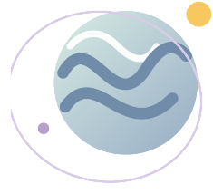<br><b>الثبات</b><br><sub>تعامل مع الضغط خطوة بخطوة</sub></td>
<td align="center" width="16%">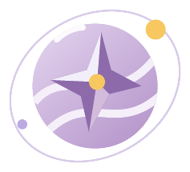<br><b>البوصلة</b><br><sub>اختر بوضوح</sub></td>
<td align="center" width="16%">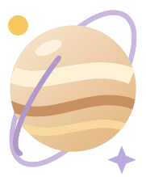<br><b>الانطلاقة</b><br><sub>بداية تناسبك</sub></td>
</tr>
</table>

من تمارين **كوكب السكينة**:

- 🌦️ **طقس الداخل**: صِف مزاجك كأنه حالة طقس.
- 🌟 **المدار**: قرّب النجمة من الكوكب أو بعّدها لتعبّر عن شدة شعورك.
- ☁️ **كلمات في السماء**: اختر الكلمات التي تشبه ما تشعر به.
- 🫀 **خريطة الجسد**: حدّد أين تشعر بالشعور في جسدك.
- 🧵 **الفكرة والغرفة**: فكّ تشابك فكرة وأعطِها مساحة.
- 🏅 **ملخّص متحرك** يعرض تقدّمك في نهاية كل محطة.

---

## 🚀 المميزات

<table>
<tr><td valign="top" width="50%">

### 🧭 دعم ذاتي موجَّه
- 6 كواكب، ولكل كوكب **محطات** متعددة الخطوات
- **مكتبة أنشطة** لكل كوكب
- 🌙 **قصص قبل النوم** تساعدك على الاسترخاء
- 📓 **دفتر الامتنان**
- 📊 **لوحة الحالات** لتراجع رحلتك
- التقدّم والتأملات محفوظة **على الجهاز**

</td><td valign="top" width="50%">

### 🤖 رفيق ذكي
- **محادثة ذكية** لطيفة تعرف أين وصلت في رحلتك
- تطلب **موافقتك الصريحة** قبل أول رسالة
- **فحص أمان على الجهاز** يعمل قبل إرسال أي نص
- تنقلك إلى دعم الأزمات إذا اكتشف الفحص خطراً

</td></tr>
<tr><td valign="top">

### 🆘 الأزمات والأمان
- زر **«ساعدني الآن»** ظاهر دائماً
- **استغاثة سريعة** وخيارات للتهدئة
- **خطة أمان** شخصية
- **أرقام طوارئ** يمكن الاتصال بها بلمسة
- مسار خاص للمستخدمين **دون 18 سنة**

</td><td valign="top">

### 👩‍⚕️ المختصون *(نسخة تجريبية)*
- **دليل المختصين** مع ملفاتهم الشخصية
- **حجز المواعيد** وقائمة «مواعيدي»
- **محادثة نصية خاصة** مع مختص بعد موافقتك
- **صندوق رسائل** للمختص وتنبيهات بالرسائل الجديدة
- **تقييم الجلسة** بعد كل جلسة

</td></tr>
<tr><td valign="top">

### 🔐 الخصوصية أولاً
- **وضع الضيف**، فيمكنك استخدام التطبيق بدون حساب
- **قفل التطبيق برمز سري**
- **مركز خصوصية** واضح
- التأملات تبقى **على الجهاز**

</td><td valign="top">

### 🎨 تجربة مصمَّمة بعناية
- **نظام تصميم كوني** خاص فيه كواكب ومدارات ونجوم متحركة
- **وضع فاتح وداكن**
- خط **تجوال** المصمَّم للعربية
- لمسات صغيرة مثل **صوت** عند اختيار الكوكب
- **تذكيرات** ذكية (FCM + إشعارات محلية)

</td></tr>
</table>

---

## 📱 صور من التطبيق

<div align="center">
<table>
<tr>
<td align="center">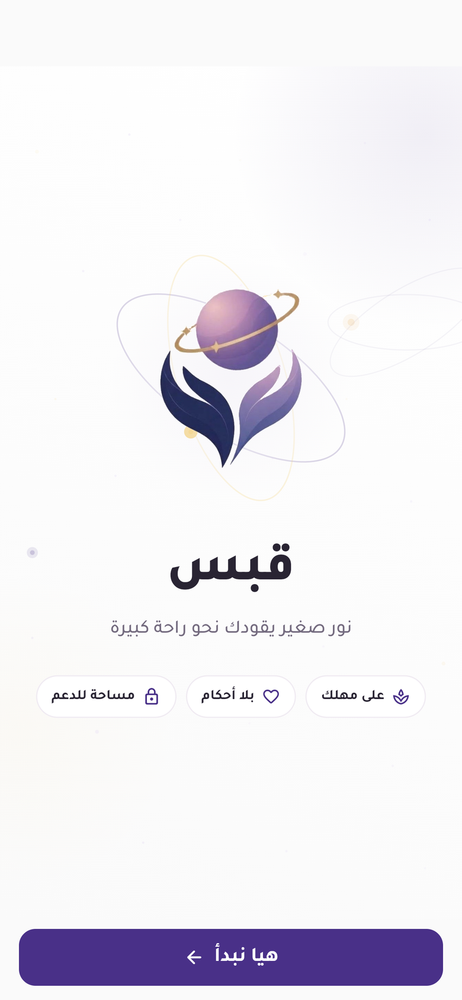<br><sub>الترحيب</sub></td>
<td align="center">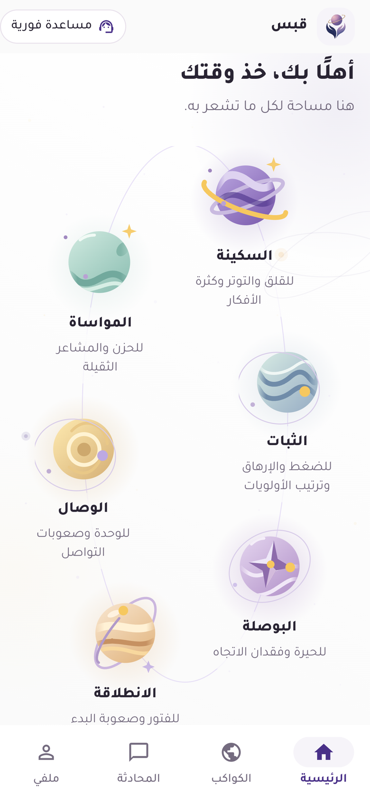<br><sub>الرئيسية</sub></td>
<td align="center">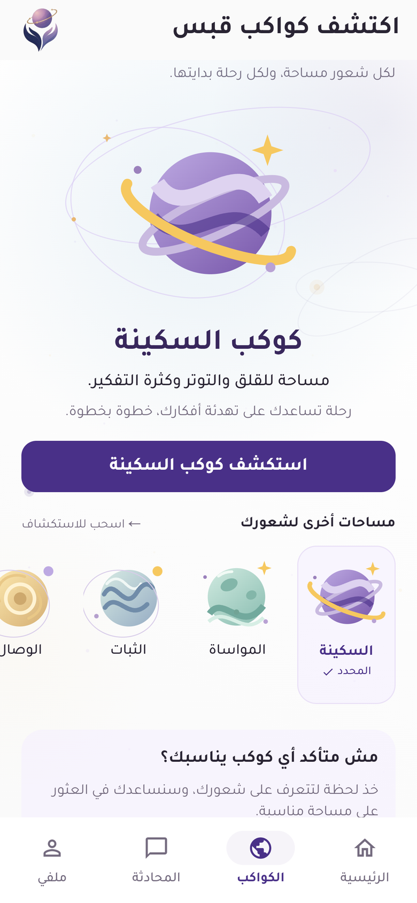<br><sub>اكتشف الكواكب</sub></td>
<td align="center">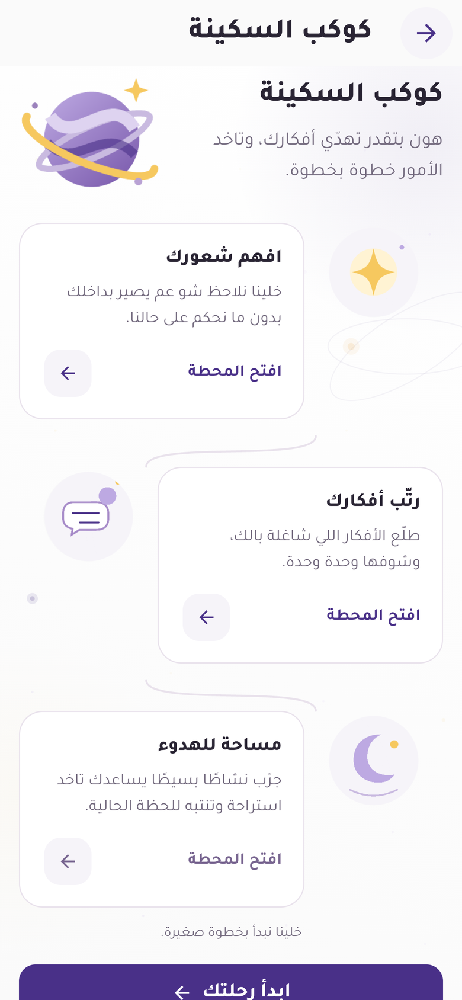<br><sub>كوكب السكينة</sub></td>
</tr>
<tr>
<td align="center">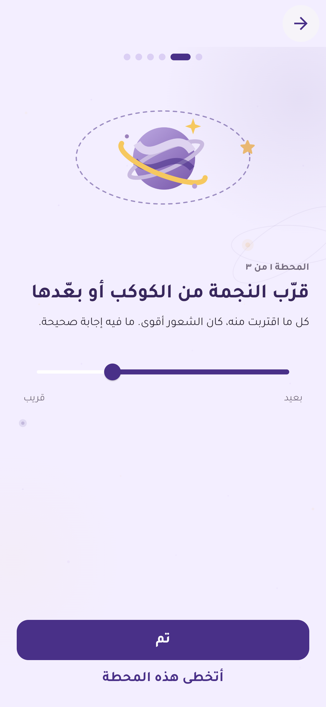<br><sub>المدار</sub></td>
<td align="center">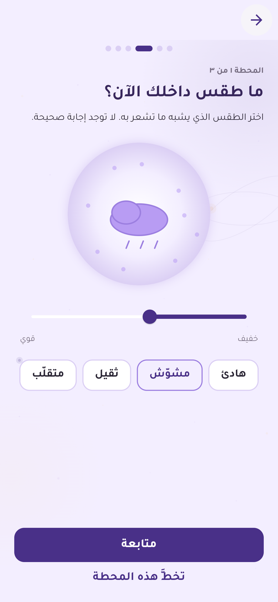<br><sub>طقس الداخل</sub></td>
<td align="center">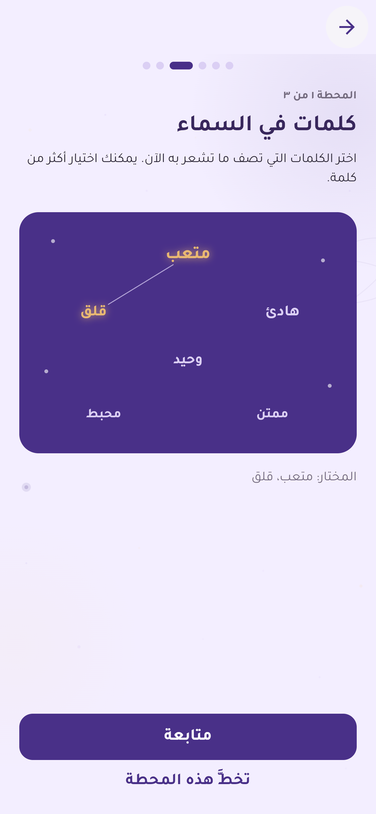<br><sub>كلمات في السماء</sub></td>
<td align="center">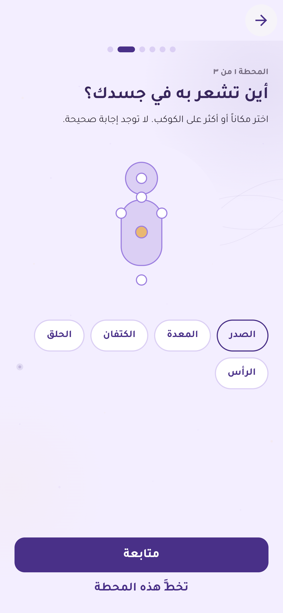<br><sub>خريطة الجسد</sub></td>
</tr>
<tr>
<td align="center">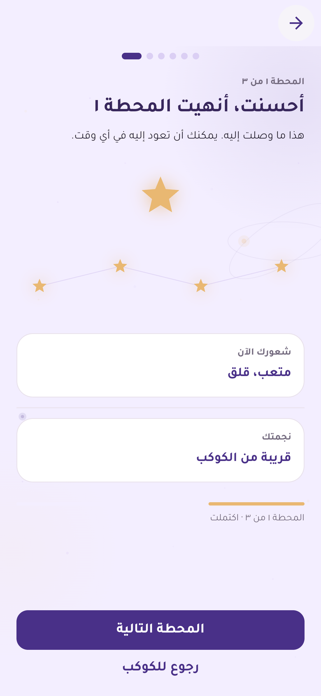<br><sub>ملخّص المحطة</sub></td>
<td align="center">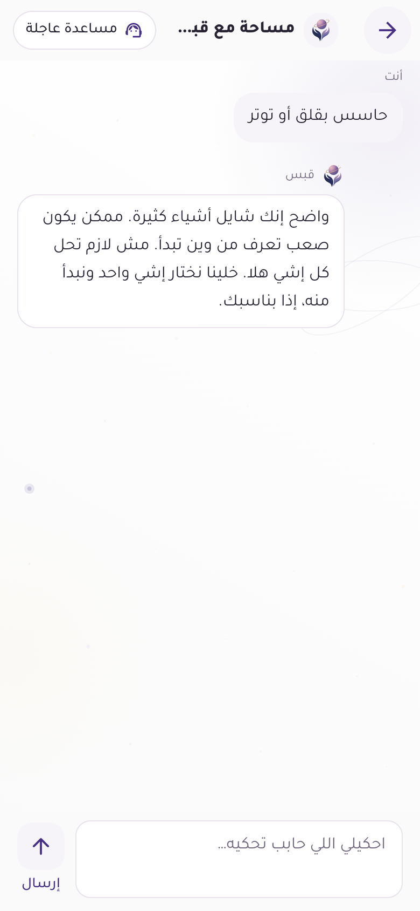<br><sub>المحادثة الذكية</sub></td>
<td align="center">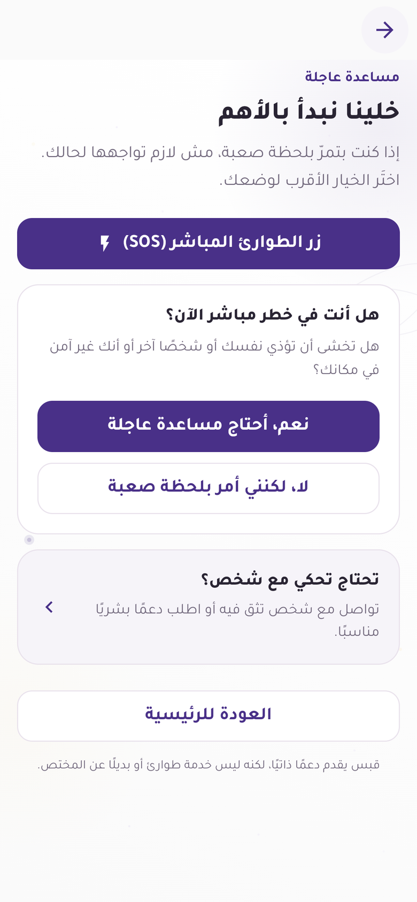<br><sub>مساعدة عاجلة</sub></td>
<td align="center">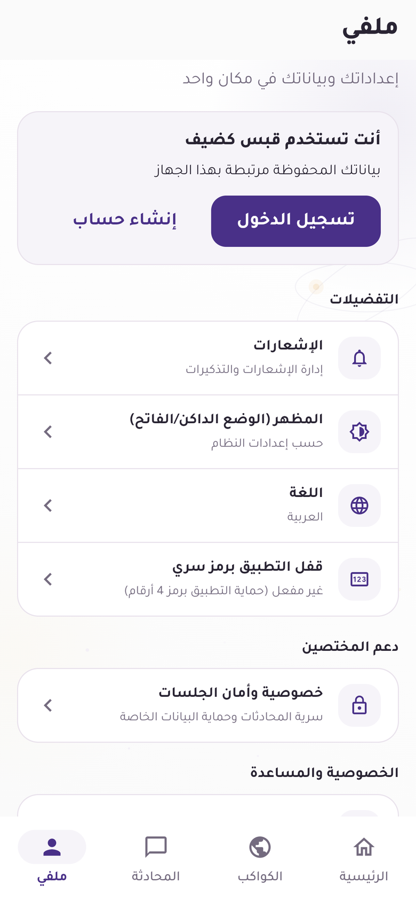<br><sub>ملفي والخصوصية</sub></td>
</tr>
</table>
</div>

---

## 🏗️ البنية المعمارية

يتبع قبس **البنية النظيفة (Clean Architecture)**، والكود مقسّم حسب **الميزة (Feature-first)**. لكل ميزة طبقاتها الثلاث: `domain` و`data` و`presentation`. تتولى GetX إدارة الحالة والتنقل وحقن الاعتماديات.

<div dir="ltr">

```
lib/
├── app/                 # App root, routes, middleware, bindings
├── core/                # Theme, localization, services, safety, shared widgets
│   ├── safety/          # On-device risk detector
│   ├── services/        # Session, notifications, sound, calls, local store
│   └── theme/           # Design tokens: colors, radius, light/dark themes
└── features/
    ├── onboarding/      # Splash, welcome, age gate, safety intro
    ├── auth/            # Sign up, login, password reset, guest mode
    ├── home/            # Main shell & planet ring
    ├── planets/         # 6 planets, stations, activities, stories, gratitude
    ├── chat/            # AI companion (consent + context builder)
    ├── crisis/          # Help now, SOS, safety plan, emergency
    ├── specialists/     # Directory, booking, private chat, inbox
    ├── states_board/    # Personal journey overview
    └── profile/         # Privacy, notifications, passcode
```

</div>

### 🧰 التقنيات المستخدمة

| المجال | التقنية |
|---|---|
| إطار العمل | Flutter 3.41+ · Dart 3.11+ |
| إدارة الحالة والتنقل والاعتماديات | GetX |
| الخادم | Firebase Auth · Cloud Firestore |
| الإشعارات | Firebase Cloud Messaging · flutter_local_notifications |
| المحادثة الذكية | واجهة نموذج لغوي (متوافقة مع OpenAI) |
| التخزين | shared_preferences (على الجهاز) |
| أخرى | audioplayers · url_launcher · equatable · timezone |

### 📈 بالأرقام

| | |
|---|---|
| 📄 ملفات Dart | **237** |
| 🧾 أسطر الكود | **~34,000** |
| 🖼️ الشاشات | **58** |
| 🧩 الوحدات (Features) | **9** |
| 🪐 الكواكب | **6** |
| 🌐 اللغات | **2** (عربي / إنجليزي) |

---

## 🔒 الكود المصدري

هذا المستودع **للعرض والتعريف** بالمشروع فقط. الكود المصدري **خاص** وغير منشور هنا.

للاطلاع على نسخة تجريبية، أو للتعاون والشراكة، أو للاستفسارات التقنية، تواصل معنا 👇

---

## 👥 فريق العمل

<div align="center">
<table>
<tr>
<td align="center" width="50%" valign="top">
<br>
<b>علا نصرالله<br><sub>Ola Nasrallah</sub></b>
<br>
<sub>مطوّرة Flutter</sub>
<br><br>
<a href="https://github.com/olanasralllah"></a>
<a href="https://www.linkedin.com/in/ola-nasrallah/"></a>
<br><br>
</td>
<td align="center" width="50%" valign="top">
<br>
<b>أحمد أكرم أبو العجين<br><sub>Ahmad Akram Abu Elajeen</sub></b>
<br>
<sub>أمن سيبراني وشبكات · مطوّر Flutter</sub>
<br>
<sub>📍 غزة، فلسطين</sub>
<br><br>
<a href="https://github.com/ahmad-ajeen"></a>
<a href="https://www.linkedin.com/in/ahmad-akram-abu-elajeen-07a4aa24b"></a>
<a href="mailto:aa.aajeen@gmail.com"></a>
<br><br>
</td>
</tr>
</table>
</div>

---

<div align="center">

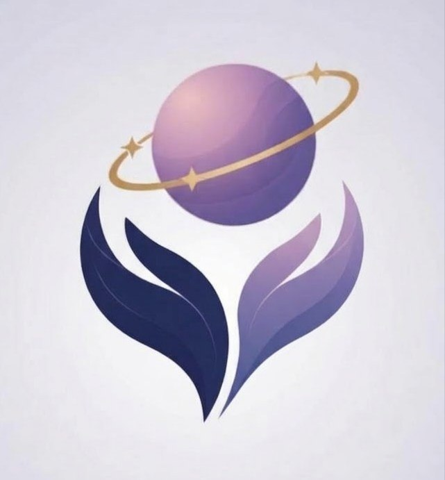

<sub>© قبس. جميع الحقوق محفوظة.</sub>
<br>
<sub>⚠️ قبس أداة للدعم الذاتي ولا يغني عن التشخيص أو العلاج المتخصص. إذا كنت في خطر، تواصل مع خدمات الطوارئ المحلية.</sub>

</div>

</div>
