<div align="center">

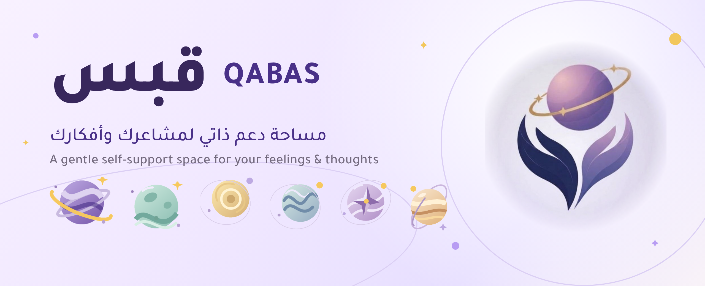

<br>

**🇬🇧 English** · [🇸🇦 العربية](README.ar.md)

<br>


%20·%20English-E9B872?style=flat-square)


</div>

---

## ✨ About Qabas

**Qabas** (Arabic: *قبس*, “a spark of light”) is an Arabic-first mental wellbeing app. It gives people a calm, private space to understand their feelings, organise their thoughts and take small, kind steps forward.

Instead of clinical forms, Qabas turns self-support into a **journey through six planets**. Each planet focuses on one need, such as calming down, being kind to yourself or making a decision, and is split into short, guided **stations** with interactive, animated exercises.

Safety is part of the design. A **“Help now”** button is always one tap away, and a local safety check runs on the device before any text is sent anywhere.

> 💜 Written in natural Levantine Arabic, fully right-to-left, with an English interface also available.

---

## 🪐 The Six Planets

<table>
<tr>
<td align="center" width="16%">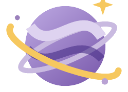<br><b>Serenity</b><br><sub>السكينة</sub><br><sub>Understand what you feel</sub></td>
<td align="center" width="16%">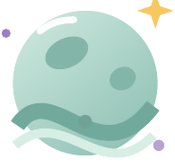<br><b>Compassion</b><br><sub>المواساة</sub><br><sub>Be gentle with yourself</sub></td>
<td align="center" width="16%">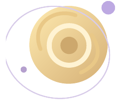<br><b>Connection</b><br><sub>الوصال</sub><br><sub>Find what you need from others</sub></td>
<td align="center" width="16%">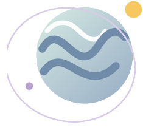<br><b>Stability</b><br><sub>الثبات</sub><br><sub>Handle pressure step by step</sub></td>
<td align="center" width="16%">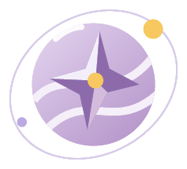<br><b>Compass</b><br><sub>البوصلة</sub><br><sub>Make decisions with clarity</sub></td>
<td align="center" width="16%">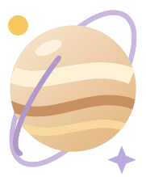<br><b>Launch</b><br><sub>الانطلاقة</sub><br><sub>Get started when it feels hard</sub></td>
</tr>
</table>

Some of the exercises inside **Serenity**:

- 🌦️ **Inner Weather**: describe your mood as weather.
- 🌟 **The Orbit**: move a star closer to or further from the planet to show how intense a feeling is.
- ☁️ **Words in the Sky**: choose the words that fit what you feel.
- 🫀 **Body Map**: point to where you feel it in your body.
- 🧵 **Thought & Room**: untangle a thought and give it some space.
- 🏅 **Station summaries** with animated progress at the end of each station.

---

## 🚀 Features

<table>
<tr><td valign="top" width="50%">

### 🧭 Guided Self-Support
- 6 themed planets with multi-step **stations**
- An **activity library** for each planet
- 🌙 **Bedtime stories** to help you relax before sleep
- 📓 **Gratitude journal**
- 📊 **States board** to look back at your journey
- Progress and reflections saved **on the device**

</td><td valign="top" width="50%">

### 🤖 AI Companion
- A gentle **AI chat** that knows where you are in your journey
- Asks for **explicit consent** before the first message
- An **on-device risk check** runs before any text is sent
- Moves you to crisis support when the risk check finds something

</td></tr>
<tr><td valign="top">

### 🆘 Crisis & Safety
- A **“Help now”** button that is always visible
- **Quick SOS** and grounding options
- A personal **safety plan**
- **Emergency numbers** with one-tap calling
- A separate path for **under-18** users

</td><td valign="top">

### 👩‍⚕️ Specialists *(pilot)*
- A **directory** of specialists with their profiles
- **Appointment booking** and a “My appointments” list
- **Consent-first** private text chat with a specialist
- A specialist **inbox** and incoming-message alerts
- **Session feedback** after each session

</td></tr>
<tr><td valign="top">

### 🔐 Privacy First
- **Guest mode**, so you can use the app without an account
- An app **passcode lock**
- A clear **privacy center**
- Reflections stay **on the device**

</td><td valign="top">

### 🎨 Crafted Experience
- A custom **cosmic design system** with animated planets, orbits and stars
- **Light & dark** themes
- The **Tajawal** typeface, built for Arabic
- Small touches such as **sound** when choosing a planet
- Smart **reminders** (FCM + local notifications)

</td></tr>
</table>

---

## 📱 Screenshots

<div align="center">
<table>
<tr>
<td align="center">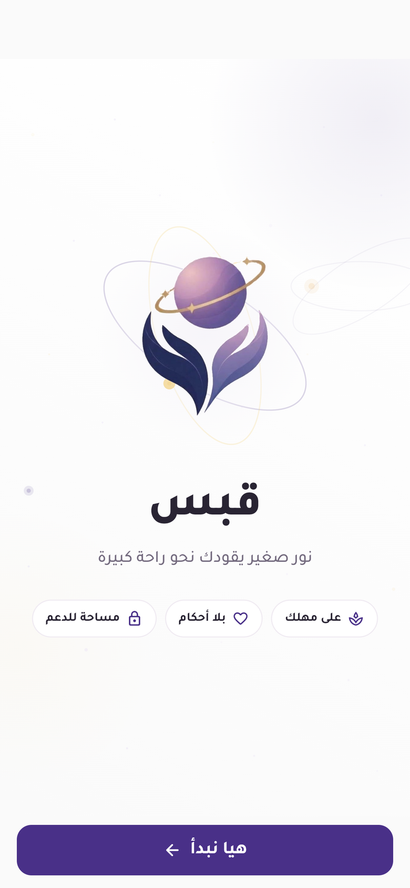<br><sub>Welcome</sub></td>
<td align="center">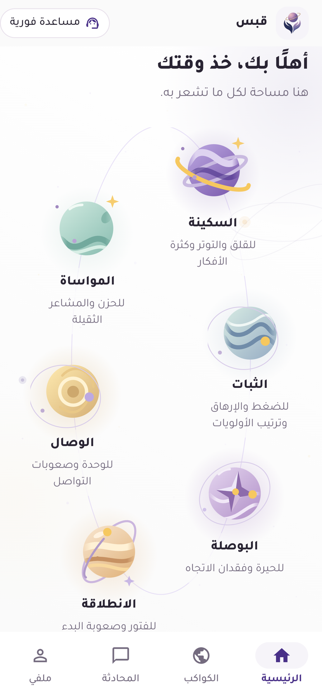<br><sub>Home</sub></td>
<td align="center">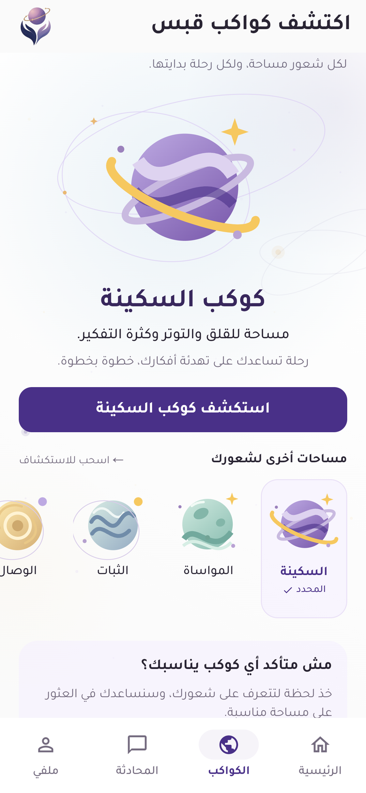<br><sub>Explore planets</sub></td>
<td align="center">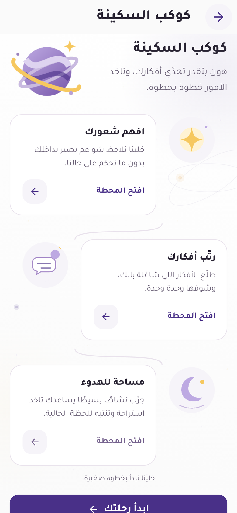<br><sub>Serenity planet</sub></td>
</tr>
<tr>
<td align="center">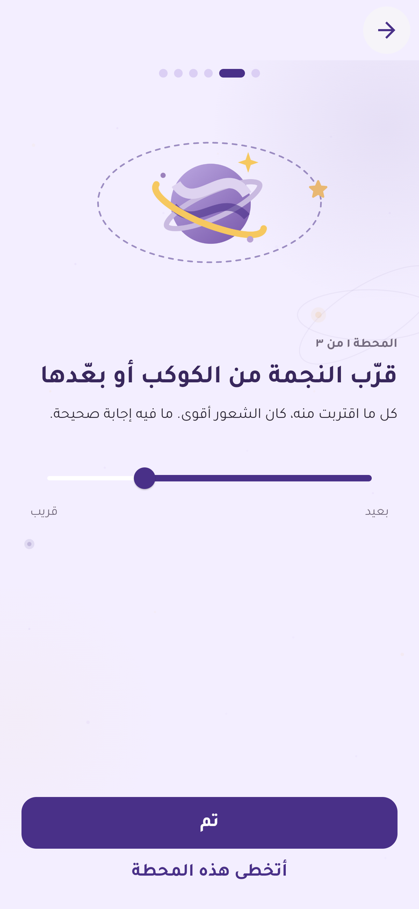<br><sub>The Orbit</sub></td>
<td align="center">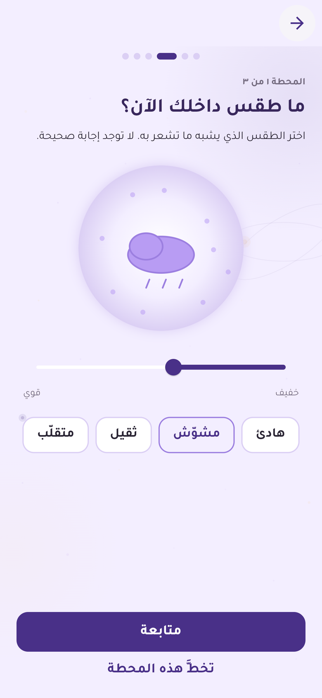<br><sub>Inner Weather</sub></td>
<td align="center">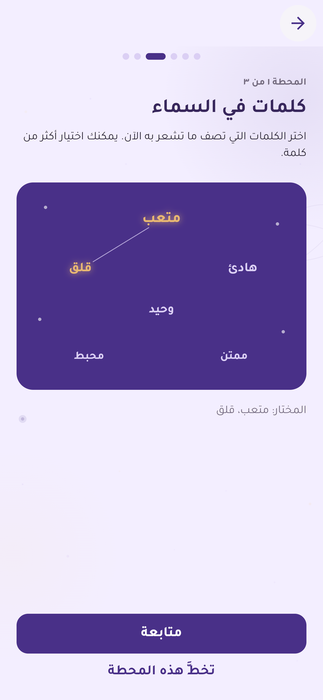<br><sub>Words in the Sky</sub></td>
<td align="center">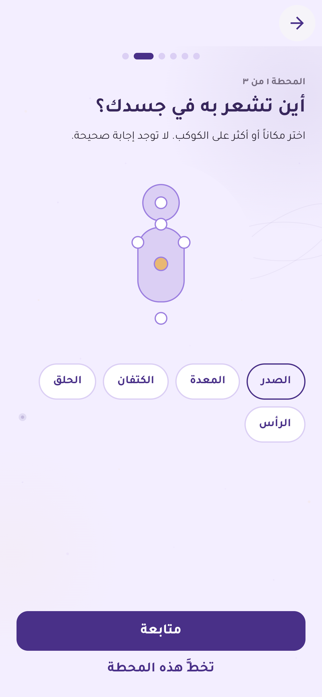<br><sub>Body Map</sub></td>
</tr>
<tr>
<td align="center">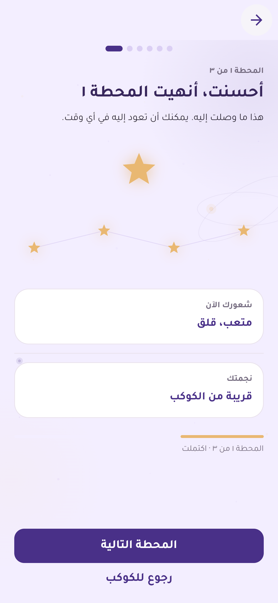<br><sub>Station summary</sub></td>
<td align="center">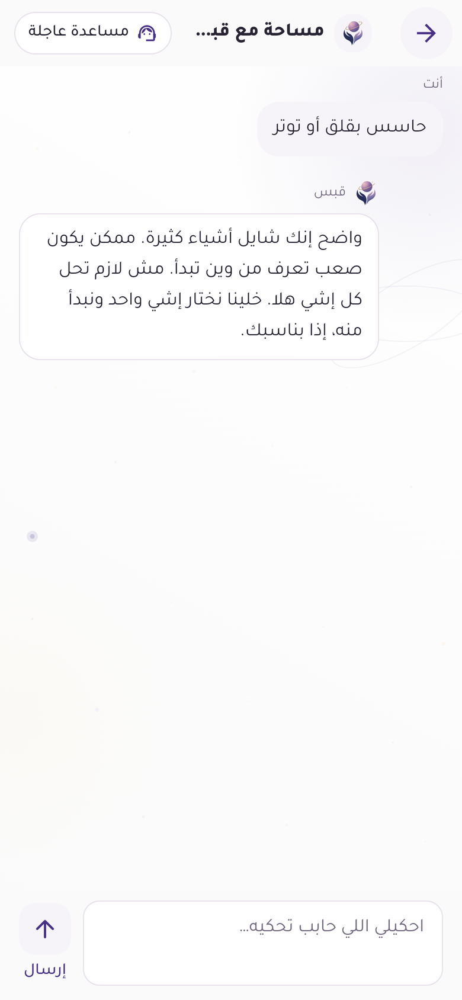<br><sub>AI companion</sub></td>
<td align="center">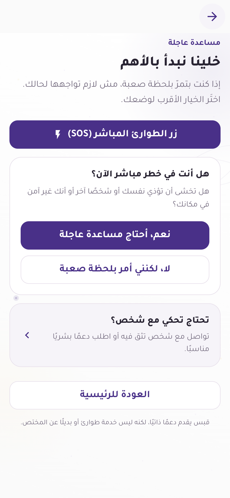<br><sub>Help now</sub></td>
<td align="center">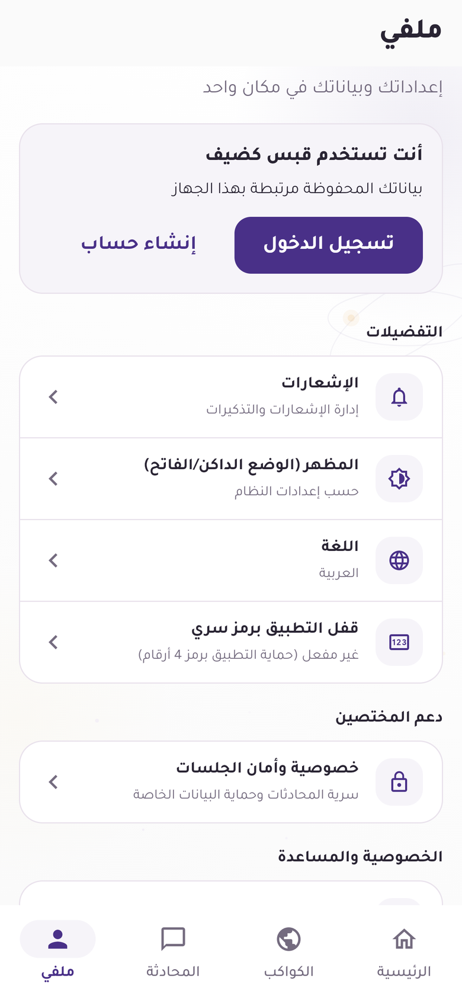<br><sub>Profile & privacy</sub></td>
</tr>
</table>
</div>

---

## 🏗️ Architecture

Qabas follows **Clean Architecture** and is organised by **feature**. Each feature has its own `domain`, `data` and `presentation` layers. GetX handles state, routing and dependency injection.

```
lib/
├── app/                 # App root, routes, middleware, bindings
├── core/                # Theme, localization, services, safety, shared widgets
│   ├── safety/          # On-device risk detector
│   ├── services/        # Session, notifications, sound, calls, local store
│   └── theme/           # Design tokens: colors, radius, light/dark themes
└── features/
    ├── onboarding/      # Splash, welcome, age gate, safety intro
    ├── auth/            # Sign up, login, password reset, guest mode
    ├── home/            # Main shell & planet ring
    ├── planets/         # 6 planets, stations, activities, stories, gratitude
    ├── chat/            # AI companion (consent + context builder)
    ├── crisis/          # Help now, SOS, safety plan, emergency
    ├── specialists/     # Directory, booking, private chat, inbox
    ├── states_board/    # Personal journey overview
    └── profile/         # Privacy, notifications, passcode
```

Each feature is built like this:

```
feature/
├── domain/        → entities · repository contracts · use cases
├── data/          → repository implementations · remote / mock / local data sources
└── presentation/  → GetX controllers · views · widgets
```

### 🧰 Tech Stack

| Area | Technology |
|---|---|
| Framework | Flutter 3.41+ · Dart 3.11+ |
| State, routing & DI | GetX |
| Backend | Firebase Auth · Cloud Firestore |
| Notifications | Firebase Cloud Messaging · flutter_local_notifications |
| AI chat | LLM API (OpenAI-compatible) |
| Storage | shared_preferences (on-device) |
| Other | audioplayers · url_launcher · equatable · timezone |

### 📈 In numbers

| | |
|---|---|
| 📄 Dart files | **237** |
| 🧾 Lines of code | **~34,000** |
| 🖼️ Screens | **58** |
| 🧩 Feature modules | **9** |
| 🪐 Planets | **6** |
| 🌐 Languages | **2** (AR / EN) |

---

## 🔒 Source Code

This repository is a **showcase** of the project. The source code is **private** and is not published here.

If you are interested in a demo, a collaboration or partnership, or the technical details, please get in touch 👇

---

## 👥 Team

<div align="center">
<table>
<tr>
<td align="center" width="50%" valign="top">
<br>
<b>Ola Nasrallah</b>
<br>
<sub>Flutter Developer</sub>
<br><br>
<a href="https://github.com/olanasralllah"></a>
<a href="https://www.linkedin.com/in/ola-nasrallah/"></a>
<br><br>
</td>
<td align="center" width="50%" valign="top">
<br>
<b>Ahmad Akram Abu Elajeen</b>
<br>
<sub>Cybersecurity & Networking · Flutter Developer</sub>
<br>
<sub>📍 Gaza, Palestine</sub>
<br><br>
<a href="https://github.com/ahmad-ajeen"></a>
<a href="https://www.linkedin.com/in/ahmad-akram-abu-elajeen-07a4aa24b"></a>
<a href="mailto:aa.aajeen@gmail.com"></a>
<br><br>
</td>
</tr>
</table>
</div>

---

<div align="center">

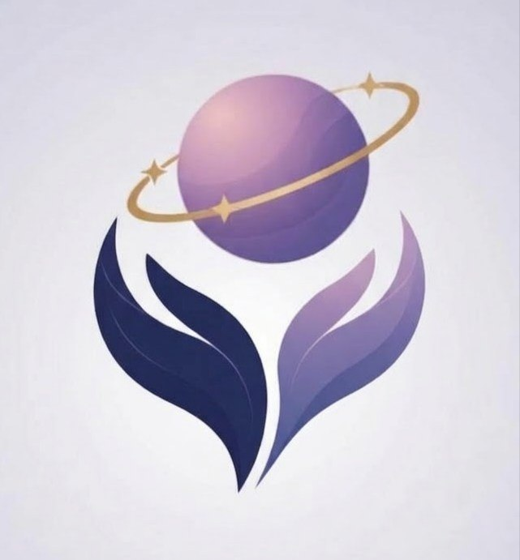

<sub>© Qabas. All rights reserved.</sub>
<br>
<sub>⚠️ Qabas is a self-support tool. It does not replace professional diagnosis or treatment. If you are in danger, contact your local emergency services.</sub>

</div>
